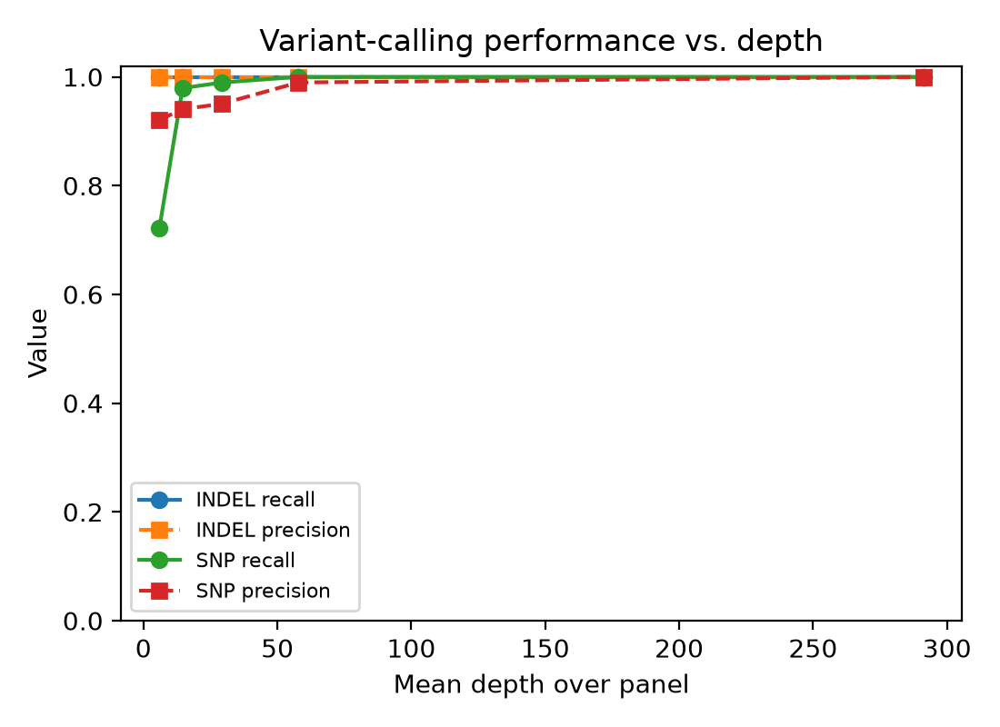
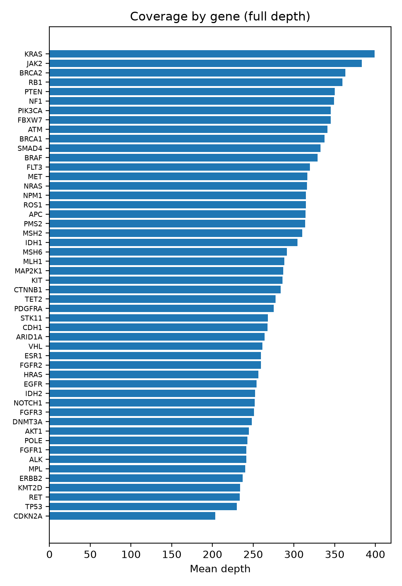

# NGS Panel Benchmark: Variant Calling Performance on a Panel of 50 Cancer Genes

[](https://github.com/MaryOlufunmilola/ngs-panel-benchmark/actions/workflows/ci.yml)

How well does a standard variant calling workflow perform on a targeted oncology panel, and how
quickly does performance degrade as sequencing depth drops? This project answers both on
**GIAB HG002**, a reference sample whose variants are known with high confidence, restricted to the
coding exons of 50 commonly profiled cancer genes.

> **Status:** complete. Results below are from a full run on GIAB HG002 (GENCODE v50, hap.py 0.3.15), October 22, 2026.

## What it measures

| Question | Metric | Tool |
|---|---|---|
| Is the panel covered evenly? | Mean depth; % bases at 20x/50x/100x; uniformity (% bases >= 0.2x mean); depth per gene | mosdepth + `src/panelbench.py` |
| How accurate are the calls? | Recall (sensitivity), precision, F1, separately for SNVs and indels, within GIAB high confidence regions | hap.py (or exact match fallback) |
| How does depth affect detection? | The same metrics after downsampling reads (20%, 10%, 5%, and 2% of a ~300x sample, set in `config/settings.sh`) | samtools + `src/cli.py collect` |
| Which calls have known clinical records? | ClinVar significance for calls at full depth (optional) | bcftools annotate |

## Pipeline

1. **Panel:** coding exons of the genes in `config/genes.txt`, padded by 10 bp and merged (from the GENCODE GTF).
2. **Reads:** extract HG002 reads over the panel only.
3. **Evaluation regions:** panel intersected with GIAB high confidence regions; truth variants normalized.
4. **For each depth fraction:** coverage (mosdepth), variant calling (bcftools mpileup/call, normalized), and comparison with the truth set (hap.py, or an exact match fallback).
5. **Summary:** `results/titration_metrics.csv`, `results/sensitivity_vs_depth.png`, `results/coverage_by_gene.png`.

## Results

**Panel:** 50 genes, 1,066 intervals, 214,419 bp. Of these, 210,782 bp fall in GIAB high confidence
regions and are scored; they contain **97 truth SNVs and 3 truth indels**. Reads: GIAB HG002
Illumina, ~291x mean depth over the panel at full depth, with 99.998% of bases at or above 0.2x the
mean.

| Mean depth | Reads kept | SNV recall | SNV precision | SNV F1 | SNV missed / false | Indels found |
|---|---|---|---|---|---|---|
| ~291x | 100% | 1.000 | 1.000 | 1.000 | 0 / 0 | 3 of 3 |
| ~58x | 20% | 1.000 | 0.990 | 0.995 | 0 / 1 | 3 of 3 |
| ~29x | 10% | 0.990 | 0.950 | 0.970 | 1 / 5 | 3 of 3 |
| ~15x | 5% | 0.979 | 0.941 | 0.960 | 2 / 6 | 3 of 3 |
| ~6x | 2% | 0.722 | 0.921 | 0.809 | 27 / 6 | 3 of 3 |

Full table: [`results/titration_metrics.csv`](results/titration_metrics.csv).





### Takeaways

SNV recall stays at 0.98 or higher down to about 15x and then drops off quickly: at about 6x,
27 of the 97 truth SNVs are missed. Precision also slips as depth falls, from no false positives
at full depth to five or six at 29x and below.

Every gene averaged roughly 200x or more at full depth, from about 400x (KRAS) down to about
200x (CDKN2A). The lowest were CDKN2A, TP53, RET, and KMT2D. CDKN2A is high in GC content, which usually
lowers Illumina coverage; TP53 being near the bottom is worth noting given how often it is
mutated in cancer.

All 3 indels were found at every depth, but three is far too few to say anything about indel
sensitivity.

### Something I ran into

In my first full run, all 3 indels disappeared at full depth even though every downsampled run
found them. The cause was a bcftools default: `mpileup` skips indel calling when the average
depth is above 250x (`-L/--max-idepth`). This sample is ~291x, so indels were never called.
`run_benchmark.sh` now sets `-L 1000`. Worth checking in any panel pipeline with very deep coverage.

## Inputs and outputs

| | File | Format |
|---|---|---|
| **Input** | Reference genome | GRCh38 FASTA + `.fai` index |
| | Gene annotation | GENCODE basic GTF (`.gtf` or `.gtf.gz`); panel genes listed one per line in `config/genes.txt` |
| | Reads | HG002 BAM/CRAM aligned to GRCh38, with index (local path or https URL) |
| | Truth set | GIAB v4.2.1 VCF (`.vcf.gz` + `.tbi`) and high confidence BED |
| **Output** | `data/panel.bed` | Panel intervals: chrom, start (0-based), end, gene |
| | `results/titration_metrics.csv` | One row per depth fraction and variant type: mean depth, uniformity, truth total, TP, FN, FP, recall, precision, F1 |
| | `results/frac_<f>/coverage_summary.json`, `coverage_per_gene.csv` | Mean depth, % bases at 20x/50x/100x, uniformity; depth per gene |
| | `results/sensitivity_vs_depth.png`, `coverage_by_gene.png` | Recall and precision vs. depth; coverage per gene |
| | `results/clinvar_matches.tsv` (optional) | Calls at full depth with a ClinVar record |

Download links and file names: [`data/README.md`](data/README.md).

## Quick check with toy data (no downloads)

`example/` has tiny handmade inputs (a GTF with 3 genes, coverage files, and truth and call VCFs at four
depths, with a planted 20 bp coverage dropout and known missed and false calls). One command runs
the panel, coverage, comparison, and summary steps and checks the result against a saved answer:

```bash
pip install pandas matplotlib
bash example/run_example.sh
```

| | |
|---|---|
| Inputs | `example/make_toy_inputs.py` writes them to `example/toy_inputs/` (the docstring lists what is planted) |
| Expected output | [`example/expected/titration_metrics.csv`](example/expected/titration_metrics.csv), e.g. SNV recall 1.0, 0.9, 0.7, 0.4 as depth drops from 119x to 12x |
| Your output | `example/work/results/` (same layout as a real run, including both plots) |

The toy run skips the steps that need external tools (samtools, bcftools, mosdepth, hap.py); those
are covered by the full run. It also runs as part of `pytest`.

## Time and resources

| Run | Time | Disk |
|---|---|---|
| Toy example | a few seconds | under 1 MB |
| Full benchmark | Mostly the time to stream panel reads from GIAB, so it depends on your connection; reruns reuse the cached reads and finish in minutes | 6.1 GB of inputs in `data/` (reference, annotation, truth set, panel reads); 37 MB of results |

Runs on a laptop (I used a MacBook Pro): only the panel regions are processed.

## Run

Step by step instructions, including downloads and troubleshooting: [`RUNNING.md`](RUNNING.md).

```bash
conda env create -f environment.yml && conda activate panelbench
docker pull --platform linux/amd64 quay.io/biocontainers/hap.py:0.3.15--py27hcb73b3d_0   # optional, recommended
# download inputs (RUNNING.md, step 3); check config/settings.sh
bash run_benchmark.sh
```

## Tests

```bash
pip install -r requirements-dev.txt && pytest
```

Unit tests cover panel construction from a GTF (coordinate conversion, padding, merging,
missing genes, BED column order), coverage and uniformity calculations (including uncovered gaps),
the comparison with the truth set by variant type, hap.py output parsing, and the toy example end to end.
CI runs them on every push.

## Scope and limitations

- **Germline, not somatic.** HG002 variants are germline, at allele fractions near 50% or 100%.
  This benchmark measures detection versus depth, not a somatic limit of detection.
- **Next step for somatic LOD:** mix reads from two GIAB samples (e.g. 10% HG002 into HG003) to create
  known variants at low allele fraction, then measure sensitivity by allele fraction.
- **Whole genome reads restricted to a panel** stand in for a targeted assay. Real amplicon or
  hybrid capture data add effects specific to the assay (primer dropout, GC bias, reads off target) not modeled here.
- The exact match fallback ignores representation differences that hap.py resolves; prefer hap.py.

## Structure

```
config/genes.txt, settings.sh   Panel genes and input paths
run_benchmark.sh                Full pipeline with logging
src/panelbench.py               Panel, coverage, comparison, and parsing helpers (unit tested)
src/cli.py                      Command line steps called by the pipeline
tests/                          Unit tests
example/                        Toy inputs, run script, and expected output
data/README.md                  Where to download inputs
```

## License

MIT; see `LICENSE`.
